# Kryptx Android Architecture

Kryptx is an offline-first, zero-network, zero-forensics Android password manager built with Jetpack Compose, Kotlin Coroutines, SQLCipher, and a high-performance native Rust cryptographic core.

---

## 🏛️ System Architecture Diagram

```mermaid
graph TD
    subgraph UI ["User Interface Layer (Jetpack Compose)"]
        Activity[MainActivity]
        NavGraph[KryptxNavGraph]
        AuthUI[UnlockScreen / BiometricPrompt]
        VaultUI[VaultDashboard / AddEditScreen]
        SecurityUI[SecurityCenter / AuditScreen]
        SettingsUI[Settings / DuressConfig]
        DesignSystem[Design System & Components]
    end

    subgraph Delegates ["Host Coordination & Delegates"]
        BioCoord[BiometricCoordinator]
        NfcDisp[NfcDispatcher]
        DispConfig[DisplayConfigurator]
        CrashDef[CrashDefense & Immortal Looper]
    end

    subgraph DI ["Dependency Injection & App Container"]
        App[KryptxApplication]
        Container[AppContainer : Closeable]
    end

    subgraph CoreSecurity ["Core Security & Session Layer"]
        SessionMgr[VaultSessionManager]
        AutoDestruct[EmergencyAutoDestructManager]
        MemWatchdog[CryptographicMemoryWatchdog]
        ClipMgr[ClipboardSecurityManager]
        DomainMatch[DomainMatcher]
        SecLogger[SecurityLogger ephemeral RAM]
    end

    subgraph CoreStorage ["Storage & Data Repositories"]
        VaultRepo[VaultRepository & VaultRepositoryImpl]
        AuthRepo[VaultAuthRepository]
        DbHelper[KryptxDatabaseHelper - SQLCipher]
        SearchIdx[HmacSearchIndex - Blind Index]
        PrefRepo[PreferencesRepository]
    end

    subgraph CoreCrypto ["Core Cryptography Layer"]
        CryptoEng[CryptoEngine]
        KeyStore[KeystoreManager]
        EntropyCalc[EntropyCalculator]
        TotpGen[TotpGenerator & Base32]
        SecureMem[SecureMemory Zeroization]
    end

    subgraph NativeRust ["Native Rust Engine (JNI)"]
        JNI[NativeCryptoEngineWrapper]
        RustCore[kryptx_crypto crate: XChaCha20-Poly1305, Argon2id]
    end

    Activity --> BioCoord
    Activity --> NfcDisp
    Activity --> DispConfig
    Activity --> NavGraph
    NavGraph --> AuthUI
    NavGraph --> VaultUI
    NavGraph --> SecurityUI
    NavGraph --> SettingsUI
    AuthUI & VaultUI & SecurityUI & SettingsUI --> DesignSystem

    App --> Container
    Container --> SessionMgr
    Container --> DbHelper
    Container --> VaultRepo
    Container --> KeyStore
    Container --> MemWatchdog
    Container --> ClipMgr
    Container --> AutoDestruct

    VaultRepo --> DbHelper
    VaultRepo --> SearchIdx
    VaultRepo --> CryptoEng
    VaultRepo --> SessionMgr

    CryptoEng --> JNI
    CryptoEng --> SecureMem
    JNI --> RustCore

    SessionMgr --> SecureMem
    DbHelper --> SecureMem
```

---

## 🔒 Security Layers & Boundaries

### 1. Zero-Network Perimeter
- `AndroidManifest.xml` does not declare `android.permission.INTERNET`, `ACCESS_NETWORK_STATE`, or `ACCESS_WIFI_STATE`.
- The app operates in complete network isolation. All breach checks (Bloom filters), password strength evaluations, and TOTP generation happen offline on-device.

### 2. Volatile Cryptographic Session Model
- Master keys (Vault Encryption Keys, VEK) and search HMAC keys reside strictly in volatile RAM.
- Keys are wrapped in `SecureMemory` and wiped in-place upon vault lock, screen timeout, app switch, or crash.
- No decrypted database key or plaintext password ever touches flash storage or unencrypted shared preferences.

### 3. Dual-Cipher Cryptographic Engine
- **Primary:** Rust-native XChaCha20-Poly1305 (24-byte extended nonce, constant-time software crypto).
- **Fallback:** Hardware-accelerated AES-256-GCM (NIST SP 800-38D §8.2.1 compliant deterministic IVs with 64-bit CSPRNG prefix + 32-bit counter).
- Payloads carry 1-byte cipher discriminator tags (`0x01`, `0x02`, `0x03`) for deterministic routing.

### 4. Hardware Keystore & Biometrics
- Master passwords derive keys through Argon2id.
- Biometric unlock relies on hardware-backed Android Keystore keys gated by `setUserAuthenticationRequired(true)`.
- Keystore keys are bound to cryptographic `Cipher` instances passed directly to `BiometricPrompt.CryptoObject`.

### 5. Blind HMAC Search Index
- Vault search queries do not expose plaintext to the SQLite database.
- Searchable tokens are transformed into `HMAC-SHA256(searchKey, token)` before storage.
- Search queries are tokenized and hashed in memory with the session HMAC key, allowing full querying without database plaintext leakage.

### 6. Sovereign Air-Gapped Animated QR Fountain Sync
- High-density animated QR code sequence codec (`AirGapQrFountainCodec`) enabling cross-device encrypted vault backups and Post-Quantum Archive transfers without network or radio protocols.
- Sequenced fountain framing with part-level CRC32 checksums, out-of-order reassembly, and full SHA-256 payload integrity verification.

### 7. Dual-Token Hardware Security Key Redundancy
- Implements `IHardwareSecurityKeyManager` with dual-token failover enrollment (Primary + Backup physical tokens).
- Supports NFC IsoDep, USB OTG HID slot 2 (instruction `0x38`), and CTAP2 BLE challenge-response derivation.

### 8. Proactive Memory Pressure Resilience
- `CryptographicMemoryWatchdog` features multi-tiered memory pressure management.
- Moderate memory pressure triggers non-essential cache pruning (identicon bitmaps, QR decoders) without disrupting the active vault session.
- Critical memory pressure executes deep zeroization (`@MustBeWiped`), defensive vault locking, and memory compaction.

