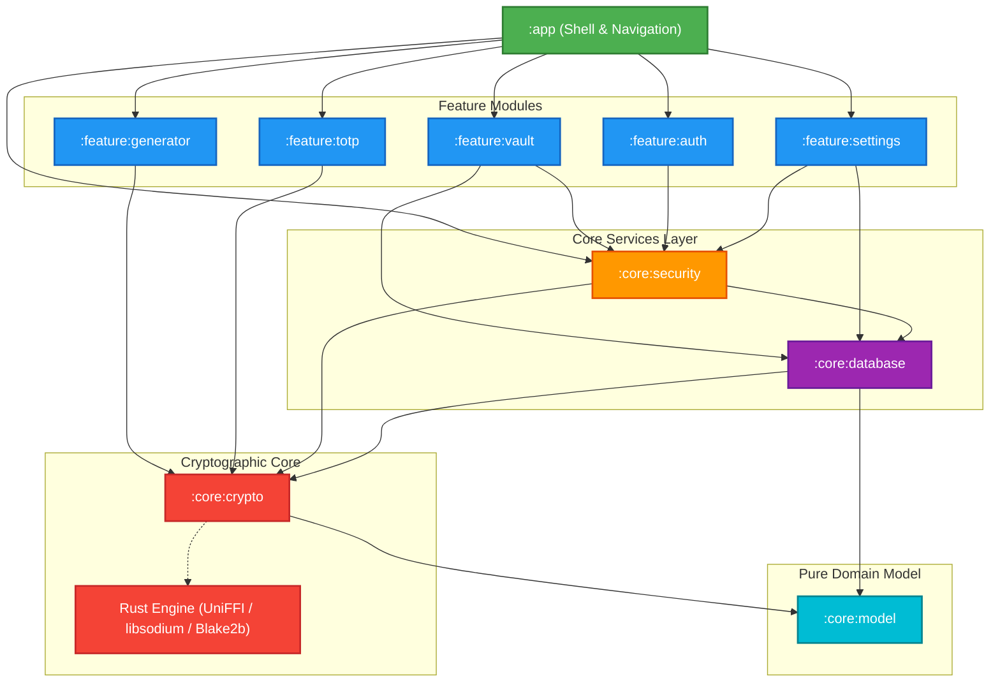
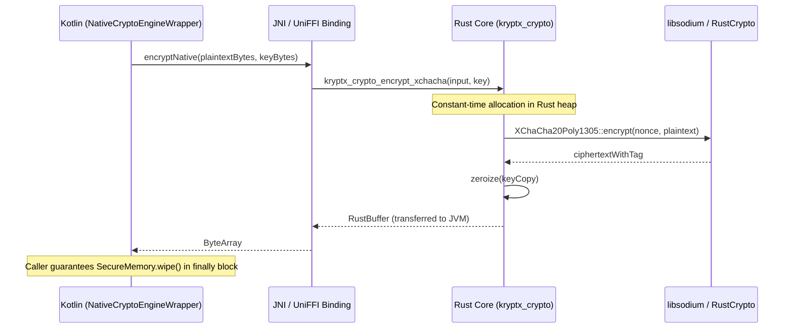

# Kryptx Multi-Module Architecture

## Visual Architecture Map

---

## Module Breakdown & Responsibilities

| Module | Purpose | Allowed Dependencies | Prohibited Concepts |
|---|---|---|---|
| **`:core:model`** | Immutable pure domain representations (`VaultItem`, `VaultCategory`, `EncryptedPayload`, `KdfConfig`). | Standard Kotlin Library only | Zero Android Framework (`android.*`), Zero UI, Zero DB |
| **`:core:crypto`** | Primitive cryptographic implementations (`XChaCha20-Poly1305`, `AES-GCM`, `Argon2Engine`, `PostQuantumEngine`, `SecureMemory`, UniFFI bridge). | `:core:model`, BouncyCastle, Android Keystore | Zero UI, Zero Database logic, Zero direct Feature calls |
| **`:core:database`** | Encrypted persistence layer (`SQLCipher`, `KryptxDatabaseHelper`, `VaultRepository`, `HmacSearchIndex`, schema migrations). | `:core:crypto`, `:core:model`, SQLCipher Android | Zero UI, Zero network calls, Zero raw unauthenticated data |
| **`:core:security`** | Application lifecycle security services (`VaultSessionManager`, `BiometricAuthManager`, `RootDetector`, `EmergencyAutoDestructManager`, `ClipboardSecurityManager`). | `:core:database`, `:core:crypto`, `:core:model` | Zero UI layouts or Composables |
| **`:feature:*`** | Specialized user journeys (Vault browsing, Credential editing, Password generation, TOTP authenticator). | Core modules via strict public interfaces | Direct database writes, manual cipher selection |

---

## Native Rust Engine Integration Flow

1. **Rust Source**: `app/src/main/rust/kryptx_crypto` contains the pure Rust crate implementing XChaCha20-Poly1305 and ML-KEM-768.
2. **UniFFI Interface Definition**: Generates type-safe C-ABI bridges and Kotlin wrappers during `cargo build`.
3. **Compilation**: Targets `arm64-v8a`, `armeabi-v7a`, `x86_64`, and `x86`.
4. **Zero-Leakage Invariant**: Memory allocated in Rust is sanitized with the `zeroize` crate before returning handles to the JVM.

---

## Architectural Rules & Enforcements

1. **Unidirectional Layering**: Dependencies only flow downward toward `:core:model`. Circular dependencies fail compilation.
2. **Interface Isolation**: Features interact with backend storage strictly through `VaultRepository` and `VaultSessionManager` interfaces.
3. **Visibility Modifiers**: Implementation helpers and low-level primitives are annotated with `internal`. Only designated public API facades are exposed across module boundaries.
4. **Air-Gap Hard Gate**: The build system strictly validates that `android.permission.INTERNET` is never introduced into any manifest.
